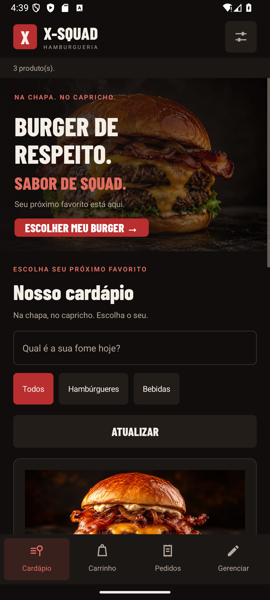
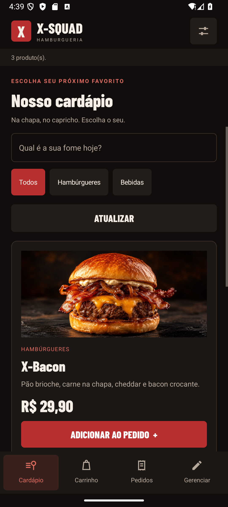
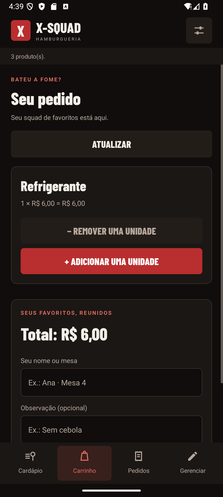
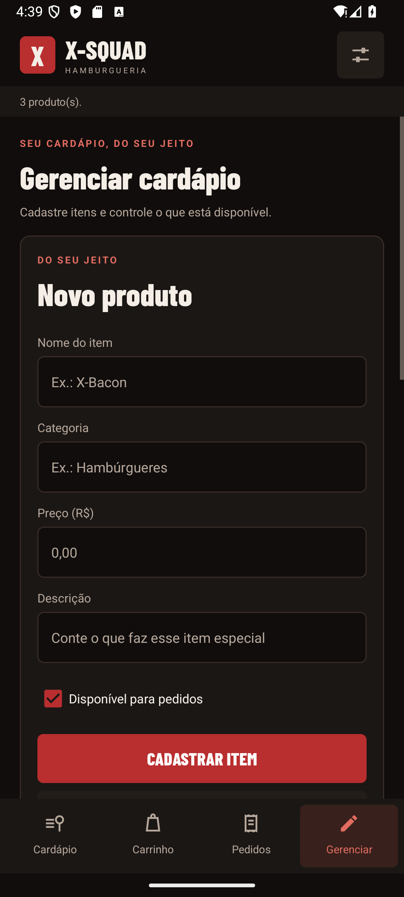

# Visual do Android inspirado no site

O app usa a mesma identidade do front-end web X-Squad do [projeto Mouseomanos](https://github.com/RyyLTS/Mouseomanos):
fundo escuro em tons quentes, vermelho, títulos Barlow Condensed e fotografias de hambúrgueres.
O nome do aplicativo no Android continua Mousseomanos; a marca X-Squad vem da referência web.

## Telas

- **Cardápio:** capa com foto e chamada para o menu, busca, filtros por categorias reais da API,
  cards com descrição, preço e botão de adicionar. Resumo do pedido com total quando houver itens.
- **Carrinho:** itens, quantidades, total e formulário de confirmação com o mesmo acabamento.
- **Pedidos:** cartões de histórico e datas formatadas em português.
- **Gerenciar:** formulário com rótulos persistentes, foco visível, preços e ações de edição/exclusão.
- **Navegação:** barra inferior fixa com ícones e identificação da tela selecionada.

As fotos são as mesmas do site e são ilustrativas. Só aparecem em hambúrgueres e combos;
bebidas e outras categorias não recebem uma foto de hambúrguer. A fonte tem sua licença
incluída em `app/src/main/assets/OFL-BarlowCondensed.txt`.

## Prévia real no emulador

As imagens abaixo usam produtos fictícios da API simulada dos testes. Nenhum desses produtos
foi cadastrado no Azure. A lista de produção continua vindo da API configurada no app.

| Início | Cardápio |
| --- | --- |
|  |  |

| Carrinho | Gerenciamento |
| --- | --- |
|  |  |

## Arquitetura e execução

As mudanças ficam na View (`MainActivity`, layout XML, estilos e recursos). O ViewModel,
o Repository, os endpoints e o back-end não foram alterados. Busca e seleção de categoria
são estado de apresentação; a categoria selecionada sobrevive à recriação da Activity.

Abra a raiz deste repositório no Android Studio e use **Run app**. Não há dependências novas
nem necessidade de fazer deploy da API.

Verificações: APK compilado, 14 testes unitários e 3 cenários de tela aprovados no Android 15,
incluindo rotação, validação, filtros e carrinho. Lint sem erros, com avisos não impeditivos.
